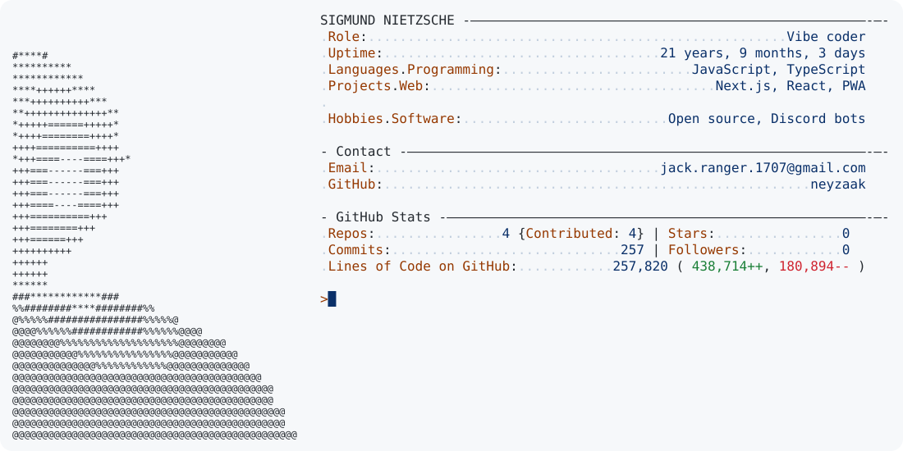

<a href="https://github.com/neyzaak"><picture><source media="(prefers-color-scheme: dark)" srcset="./output/neofetch/dark.svg"></picture></a>

<a href="https://github.com/neyzaak"><picture><source media="(prefers-color-scheme: dark)" srcset="./output/links/1-website_dark.svg"></picture></a><a href="mailto:jack.ranger.1707@gmail.com"><picture><source media="(prefers-color-scheme: dark)" srcset="./output/links/2-email_dark.svg"></picture></a>

<picture><source media="(prefers-color-scheme: dark)" srcset="./output/pacman/dark.svg"></picture>
